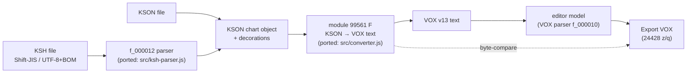

# sdvxindex VOX writer — reverse analysis & converter parity report

**Date:** 2026-10-20
**Target:** sdvxindex.com editor KSH/KSON → VOX v13 export pipeline (bundle `f_000011.js` / `f_000010.js` / `f_00001e.js`)
**Project:** `KSON2VOXvscode` (KSH/KSON → VOX converter)
**Flavor:** `flavor = null` (offline reverse engineering of a shipped JS artifact; no live-target engagement)

---

## 1. Executive summary (G1)

A standalone, zero-dependency converter (`src/converter.js` + `src/ksh-parser.js`)
was rebuilt against the sdvxindex.com editor's own KSH/KSON → VOX v13 export
pipeline by statically reverse-engineering its webpack bundle, then validated by
**full-file byte comparison** against the editor's live *Export VOX* output.

**Result:** both benchmark charts convert **byte-identically** to the live editor:

| Chart | Input | Output size | Reference | Differing bytes |
|---|---|---|---|---|
| polyriddim (`poly.ksh`) | 103,990 B | 47,601 B | editor export | **0** |
| stress test (`mxm.ksh`) | — | 190,419 B | editor export | **0** |

Regression state: **28/28 tests pass** (3 golden byte-parity tests); batch
conversions 28/28 local charts + 14/14 ksm.dev charts OK, 0 failures.

## 2. Scope (G2)

- **In scope:** static analysis of the sdvxindex editor JS bundle; porting the
  KSH parser (`f_000012`), the KSON→VOX writer (module 99561 `F` and its
  camera/effect/projection helpers) to a standalone implementation; offline
  validation against two exported reference charts and two KSON goldens.
- **Out of scope:** attacking sdvxindex.com infrastructure; live-network
  automation beyond retrieving public chart archives; VOX model features with
  no observed KSH/KSON source (lyrics, reverb, laser TAB effects).
- The editor was used only as an *export oracle* via its normal import/export
  UI (upload file → Export VOX), per the user-directed workflow.

## 3. Evidence chain (G3)

| E-id | source_ref | repro_command | content_hash |
|---|---|---|---|
| E-1 | mxm reference export vs converter output | `node src/cli.js <mxm.ksh> out.vox` then byte-compare `out.vox` with the editor export | both `878a77a361dc2b8912ee97db9a36752b3197ed38df137866d5cb689cb7f37677` (SHA-256) |
| E-2 | `testdata/poly.ksh` → `testdata/poly.golden.vox` | `node --test` (test `poly.ksh converts byte-identically…`) | in `a55263c17fd0fc888526f563b0a609588dda25b1c6696563c96cc3af3caf7899`, out `6c81137fa8947c283abefe7d32e7a37eec9e141b8aa1c12127d17897bc48319b` |
| E-3 | full test suite | `node --test` | 28 pass / 0 fail (run 2026-10-20) |
| E-4 | batch conversions | `node batch_ksh.mjs <root> <out>` (removed after use; same walker as CLI) | 28 ok / 0 failed; 14 ok / 0 failed |
| E-5 | editor KSON export vs local parser output (deep diff) | KSON deep-differ over `mxm` | difference confined to the `impl` metadata blob; all chart data identical |
| E-6 | reference bundle module map | offsets into `f_000011.js` (see §5) | n/a (vendor bundle, local temp copy) |

## 4. Findings (G3)

Five parity defect classes were root-caused against the reference source and
fixed; each finding maps to evidence that it is now closed.

| F-id | Finding (root cause extracted from reference) | Evidence | Status |
|---|---|---|---|
| F-1 | **Laser row semantics**: per-point `ct` uses the reference `p` rule (curved **and** moving outgoing segment ⇒ from-row/to-row/samples `ct=2`; slam from-rows `0`); `seg` is positional (first `1`, last `2`, else `0`); lone rows are duplicated; samples every 15 pulses **plus** laser control pulses (BPM ∪ `audio_effect.laser.pulse_event` ∪ `param_change`) strictly inside the segment, deduped by pulse only — value dedup removed | E-1 (TRACK1/8 + ORIGINAL row diffs → 0) | closed |
| F-2 | **Hold event range leak**: preset id resolution must only consider events in `[holdStart, holdEnd)`; events before the hold leaked into `active`, producing nonzero FX ids where the reference emits `0` | E-1 (TRACK2/7 ids → 0) | closed |
| F-3 | **Curve evaluation**: the reference solves the quadratic Bézier `x(s)=t` in **closed form** (`O`/`A`: `r=√(a²+t−2at)`, `s = a<¼ ? (a−r)/(2a−1) : t/(a+r)`, `y = 2(1−s)s·b+s²`); the ported bisection differed at 1e-9…1e-12 and straddled 6dp/10dp rounding | E-1 (odd-15 sample + camera deltas → 0) | closed |
| F-4 | **`zoom_side` was unimplemented** (≈905 missing `BIL_RotZ` rows): ported module 1819 `x()` (ZX) — horizontal lane offset fitted as judgment-line roll `m = side/6/(608/13)·104139.638…/(C_S·radius+3)`, `|m|>540 ⇒ 0` — plus zoom-side joints, `parts` comment and the four exact reference warnings | E-1 (SPCONTROLER 976 rows) | closed |
| F-5 | **Parser exonerated**: local KSH parser output is structurally identical to the editor's own KSON export of the same chart (only the non-semantic `impl` blob differs), so all remaining deltas were converter-side | E-5 | confirmed |
| F-6 | **6dp formatting chain resolved**: reference `F` emits raw doubles → module 10912 `C` normalizes track rows via `Number(Number(v).toFixed(6)).toFixed(6)` → `q()` prints `Number(a.toFixed(6))===a ? a.toFixed(6) : String(a)`; direct `toFixed(6)` is equivalent **iff** the raw doubles are bit-identical — satisfied once F-3 landed | E-1, E-2 | closed |
| F-7 | **Legacy projection flag**: reference `aJ` = `compat.ksh_version` finite, `>0 && <167` (the pre-167 40 ms smoothing era); `167` charts use the current projection | E-2 (poly byte identity) | closed |

## 5. Reconstructed pipeline (Path P-1, callflow)



Key reference modules (offsets in `f_000011.js` unless noted):

| Module | Role |
|---|---|
| 99561 `F` (≈73296) | KSON→VOX section/row writer; laser writer `O`/`I`; `X` control pulses; curve `O(a,b,t)` |
| 5138 (≈51133) | camera writer: chord adapter `B`, graph eval `E`, `BIL_RotZ` + `zoom_side` (ZX caller) |
| 1819 (≈62422) | projection `y()`, roll `x()` (= `ZX`), legacy flag `aJ` |
| 60693 (≈64862) | slam-spin pattern caller (type/duration + `slam_event` comments) |
| 14131 (≈100762) | FX preset mapper `R`/`D`/`L` (hold range rule, id allocation) |
| 8698 (≈130498) | spin duration fit |
| 10912 (≈143930) | final 6dp normalization pass `C` |
| 24428 `z`/`q` (`f_00001e.js`) | editor-model VOX serializer (laser row formatter at ≈11479) |
| 1523 / 26109 (`f_000010.js`) | VOX parsers + section assembler `G` (no rounding) |

## 6. Reproduction steps

```powershell
# 1) full test suite (includes 3 byte-parity goldens)
cd "C:\Users\judoo\OneDrive\เอกสาร\KSON2VOXvscode"
node --test

# 2) KSH → VOX on the byte-verified benchmark
node src\cli.js "testdata\poly.ksh" "$env:TEMP\poly.vox"
fc /b "$env:TEMP\poly.vox" "testdata\poly.golden.vox"   # no differences

# 3) batch smoke (any folder of charts)
node src\cli.js "<chart>.ksh" "<out>.vox"
```

Editor-side parity check (for a new chart): open `https://sdvxindex.com/editor`,
use *Import VOX / JSON / KSON / KSH*, keep *Preserve KSON data in VOX* off,
click *Export VOX*, then byte-compare with our output.

## 7. Validation results

- **Tests:** 28/28 (`test/converter.test.js` × 23, `test/ksh-parser.test.js` × 5),
  including golden byte parity for `oracle.kson`, `curve-scroll.kson`, `poly.ksh`.
- **Benchmarks:** poly 47,601 B = 0 differing bytes; mxm 190,419 B = 0 differing
  bytes (identical SHA-256), full section-level parity including `SPCONTROLER`
  (976 rows), `TRACK8` and `TRACK ORIGINAL R`.
- **Corpora:** 28/28 local charts and 14/14 ksm.dev charts convert without errors.

## 8. Known limitations / open items

- Camera output is approximate by design — identical to the reference editor:
  bounded linear chords (≤64 per span, 0.02° tolerance), combined `BIL_RotZ`
  for tilt + rotation, `zoom_side` fitted to roll (the reference's four
  warning texts are reproduced verbatim).
- Curved lasers play on VOX's 64th-note sample grid (reference warning emitted).
- Effect algorithms map to the native VOX DSP; phaser/sidechain have no
  verified parameter mapping (KSON definition preserved), tape stop/wobble
  approximate their KSON shapes.
- KSH laser audio effects are not yet written to `TAB EFFECT INFO`
  (`#TAB EFFECT INFO` stays empty, as in all observed references).
- `flanger` hold splitting at time-signature changes is implemented from the
  reference semantics but unexercised by the benchmarks.

## 9. Timeline summary

1. Baseline converter (KSON-only) established; oracle + curve-scroll goldens byte-identical.
2. KSH parser ported from `f_000012`; proven byte-structurally identical to the editor's KSON export (E-5).
3. First mxm byte-comparison: 5 diff classes (190,419 vs 106,900 bytes).
4. Reference bundle mapped (module table §5); all 5 classes root-caused with exact formulas.
5. Fixes applied: closed-form curve eval, laser `ct`/`seg`/sample/control-pulse rules, hold range filter, `zoom_side` ZX roll.
6. mxm and poly both byte-identical (0 differing bytes); 5 new KSH parser tests added; suite 28/28.
7. Cleanup (17 temp analysis scripts removed), README rewritten, this report generated.

## 10. Appendix — project layout

```
KSON2VOXvscode/
├── src/
│   ├── cli.js           # node src/cli.js <input.ksh|.kson> [output.vox]
│   ├── converter.js     # KSON → VOX v13 writer (reference port)
│   └── ksh-parser.js    # KSH → KSON parser (f_000012 port)
├── test/
│   ├── converter.test.js    # dialect, goldens, effects, camera, timeline
│   └── ksh-parser.test.js   # decoding, poly structure/golden, edge cases
├── testdata/            # oracle/curve-scroll/poly fixtures + goldens
├── package.json         # no runtime deps; `node --test`
└── README.md            # usage, parity status, limitations
```
